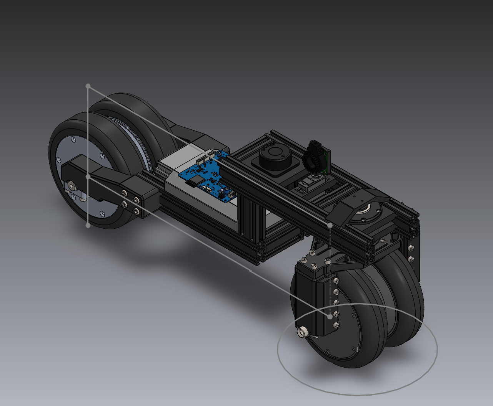
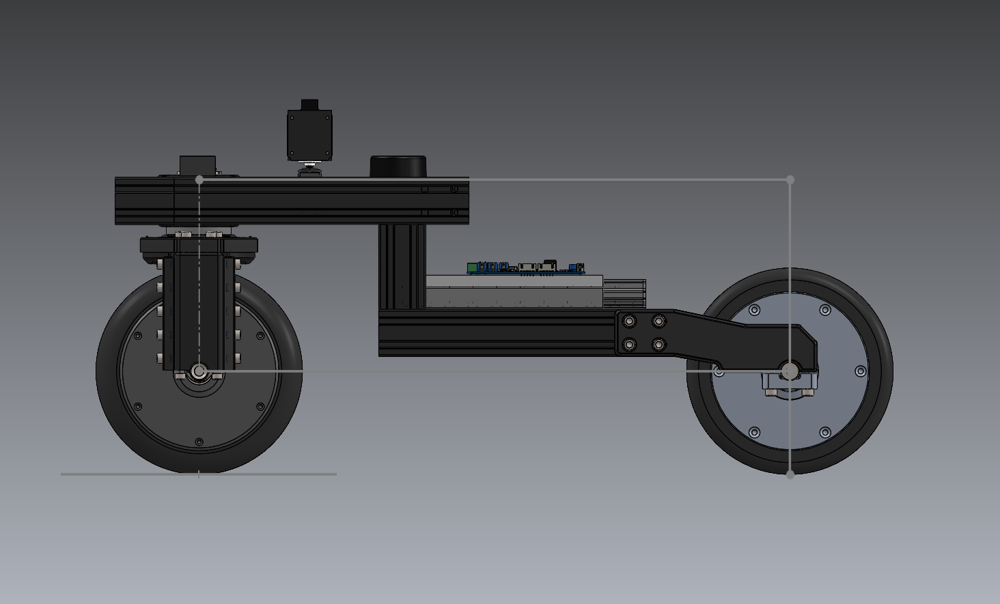
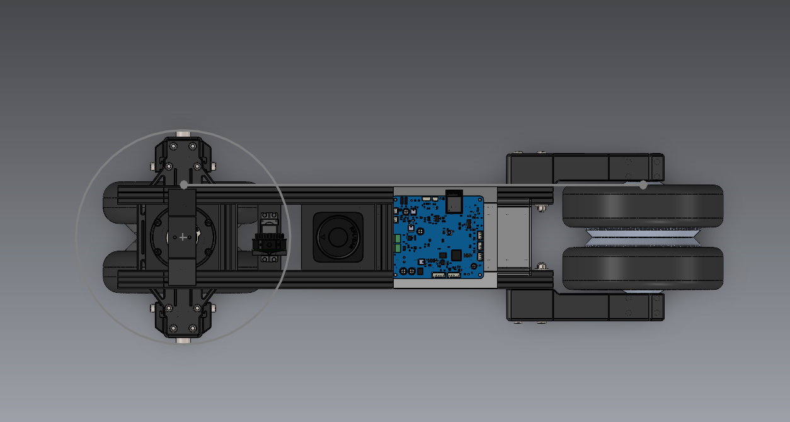
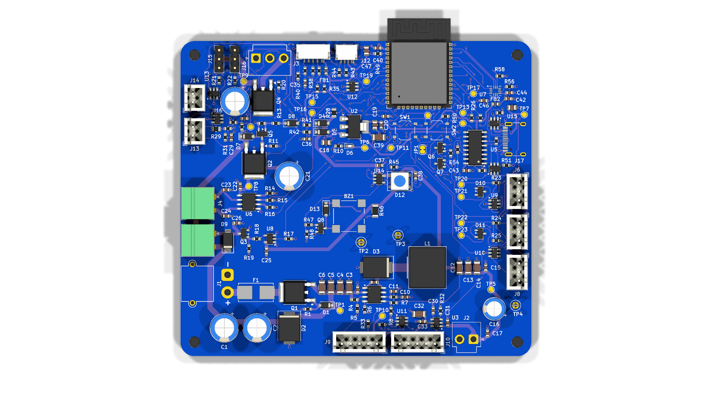
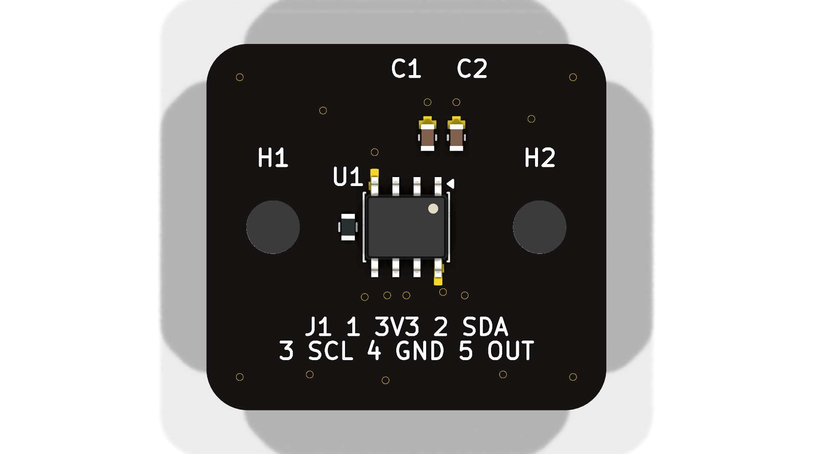

# Squashimoto

A self-driving, self-balancing surveyor robot built from salvaged hoverboard hub motors. It roams town on its own, maps and films its route, and can stand up and balance on either wheel pair for a ~1 m camera vantage.

## Why I built this

I got my hands on a couple hoverboard motors and wanted to make the best use out of them, since I've seen so many hoverboards get thrown in the trash with perfectly good components. I wanted to help improve the community, and mapping public spaces to safely collect public data like the amount of potholes in a road or streets that get flooded in the rain, so my town knows what to fix first. It'll never directly record people or private property.

## What it does

- **Drives itself:** a Raspberry Pi 3B+ plans the route using a 2D lidar (RPLIDAR C1) and GPS.
- **Maps and films:** a Pi Camera Module 3 on a servo mount records the route.
- **Stands up and balances:** the controller board's IMU runs a balance loop on either wheel pair, which lifts the camera to about 1 m.
- **Runs on salvaged parts:** the hub motors, motor boards and center tube all come from old hoverboards.
- **Custom battery pack:** a new 10S1P pack built from Molicel P26A 18650 cells (36 V, 93.6 Wh) with a 30 A BMS. The stock hoverboard pack is only for bench testing.
- **Manual control:** drive it with a DualSense Edge controller.

## Pictures

| Side | Top |
|---|---|
|  |  |

## Electronics

### Controller board (`hardware/pcb/controller/`)

A 4-layer, 100 x 90 mm board that runs off the 10S battery pack (30–42 V).

- **MCU:** ESP32-WROOM-32E, with USB-C (CH340C) for flashing
- **IMU:** ICM-42688-P for the balance loop
- **Power:** a TPS54360B buck converts the 36 V pack to 5 V at 3.5 A for the Pi, the lidar and the logic. There's also a 7 A fuse, reverse-polarity protection, a TVS diode and battery voltage sensing.
- **Motor links:** three UART connectors to the hoverboard boards (one rear, two front)
- **Other I/O:** a kickstand actuator driver (DRV8871), two servo headers, a lidar connector, an encoder connector, an e-stop loop, a battery NTC, a spare Qwiic port, a WS2812B status LED and a buzzer

Schematic: [`docs/images/controller-schematic.pdf`](docs/images/controller-schematic.pdf)

### Steering encoder board (`hardware/pcb/encoder/`)

A small 2-layer AS5600 magnetic angle sensor board that reads the front swerve pivot angle. It connects to the controller over a 5-pin JST GH cable that carries I2C plus an analog output.

Schematic: [`docs/images/encoder-schematic.pdf`](docs/images/encoder-schematic.pdf)

### Drive electronics

- **Rear pair:** GD32F103 hoverboard mainboard running [EFeru hoverboard-firmware-hack-FOC](https://github.com/EFeru/hoverboard-firmware-hack-FOC), controlled over USART at 115200 baud
- **Front pair:** GD32E230 split boards running [RoboDurden Hoverboard-Firmware-Hack-Gen2.x-GD32](https://github.com/RoboDurden/Hoverboard-Firmware-Hack-Gen2.x-GD32), sharing one UART bus with a separate slave ID per board

## Repo layout

| Path | What's there |
|---|---|
| `bom/` | Bill of materials |
| `hardware/pcb/controller/` | Controller board: KiCad project and fab files (gerbers zip) |
| `hardware/pcb/encoder/` | Encoder board: KiCad project and fab files |
| `cad/` | SolidWorks parts and assemblies, plus Bambu Studio `.3mf` print projects |
| `firmware/squashimotofirmware/` | Controller board firmware (work in progress) |
| `firmware/hoverboard/` | Notes and config for the reflashed hoverboard boards |
| `docs/images/` | Renders, schematics and CAD screenshots |
| `docs/datasheets/` | Datasheets for the parts on the boards |
| `docs/journal/` | Build journal |

## Status

V1.1 in progress. The boards and CAD are designed. The firmware is waiting on parts: it can't be tested or tuned until the boards and hoverboard hardware are here.

## License

Software (`firmware/`) is MIT. Hardware (`hardware/`, `cad/`, `bom/`, `docs/`) is CERN-OHL-S v2. See [LICENSE.md](LICENSE.md).
